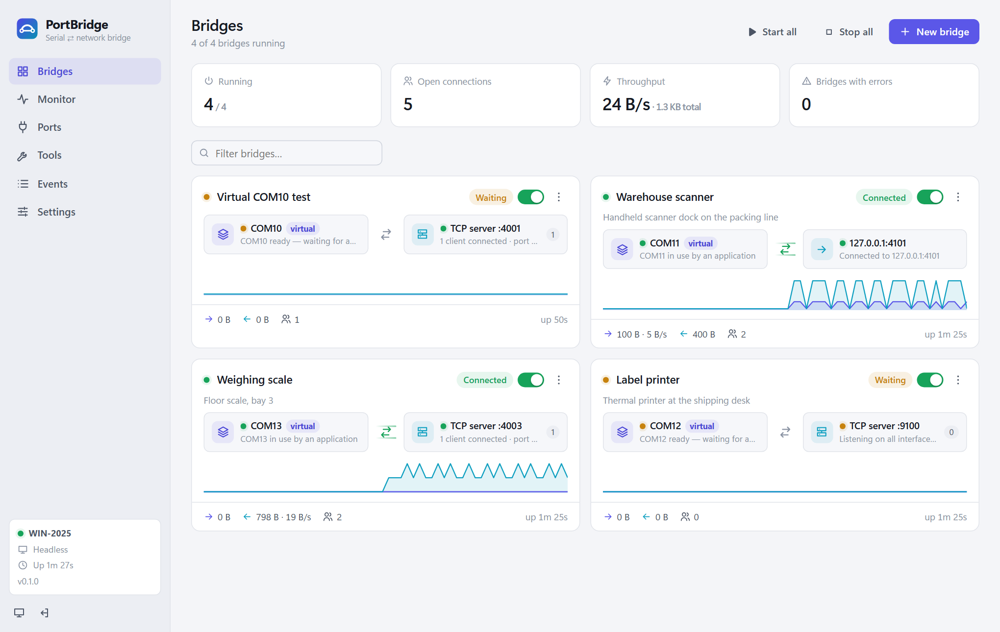
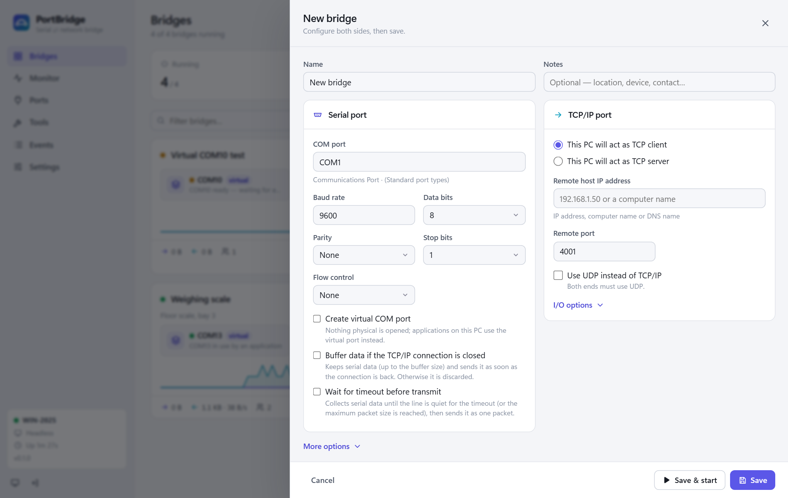
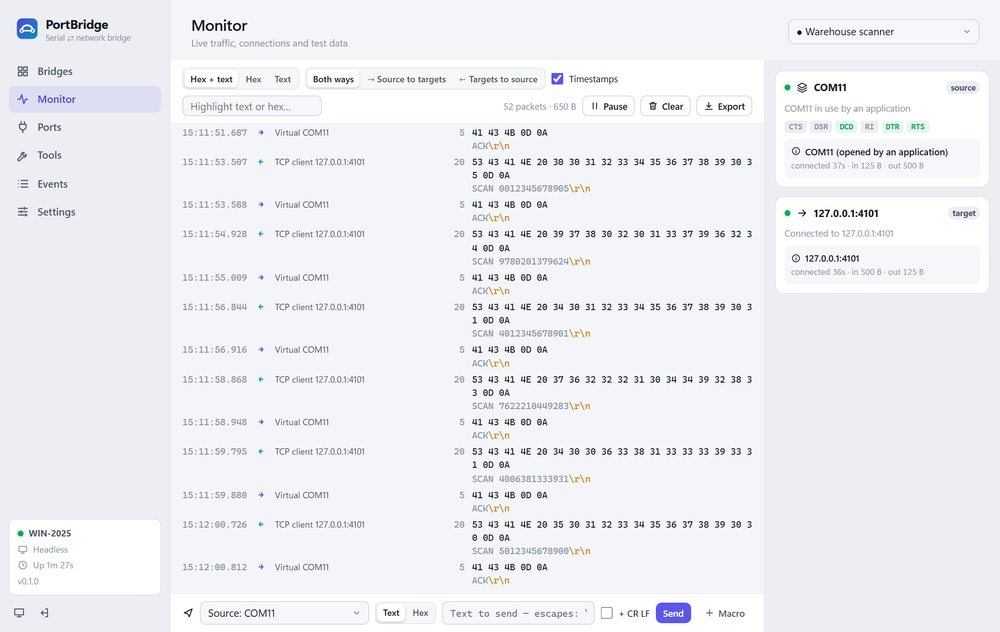
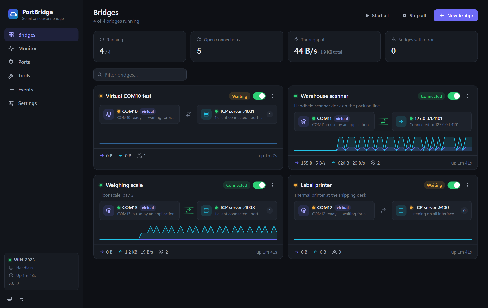
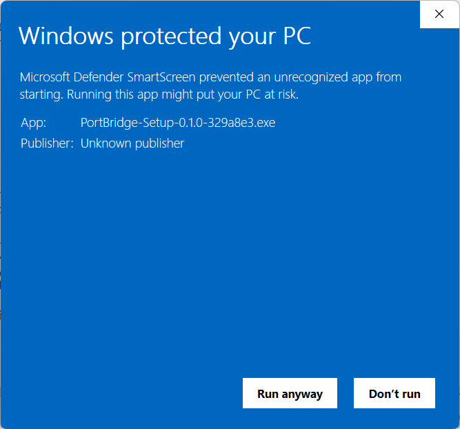
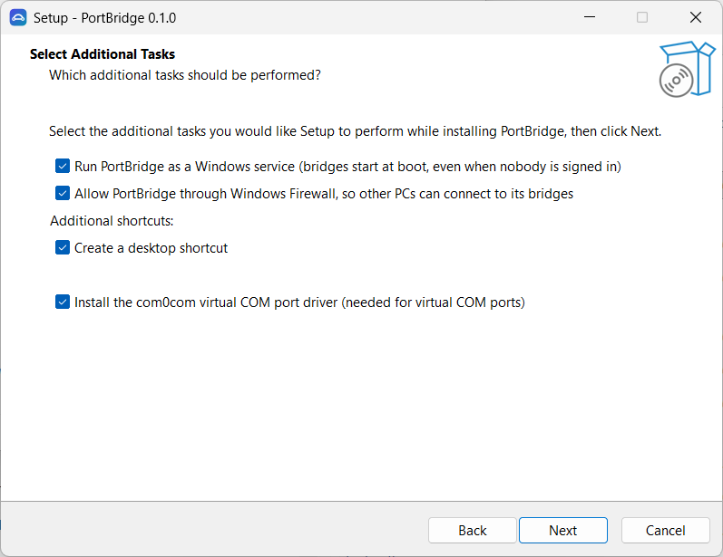
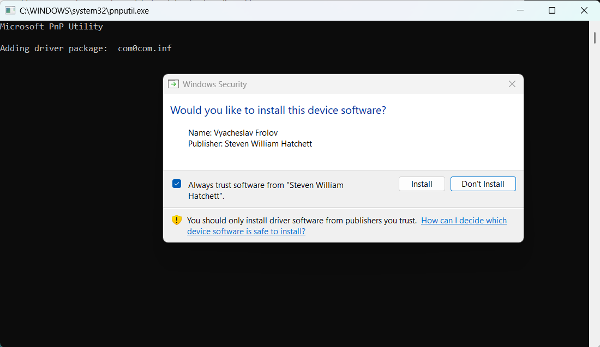

# PortBridge

A modern replacement for TalTech **TCP-Com**: bridge serial (COM) ports, virtual COM ports and TCP/UDP
connections, managed from a clean dashboard that works in its own desktop window *and* from any browser.




## What it does

A **bridge** connects a *source* endpoint to one or more *targets*. Data from the source goes to every target;
data from any target goes back to the source. Endpoint types:

| Endpoint | Use |
|---|---|
| **Serial** | A physical COM port (incl. USB adapters — automatically reopened after unplug/replug) |
| **Virtual COM** | A COM port that other software can open; created on demand through the com0com driver |
| **TCP server** | Listens for any number of clients (allow-list, client limit, first-client-only rules) |
| **TCP client** | Connects out and keeps reconnecting; optionally only while the other side is active |
| **UDP** | Datagrams to a fixed host, broadcast, or "reply to last sender" |

**New bridge** opens the same form as TCP-Com's *File → New*: a serial port on the left (a real COM port, or
*Create virtual COM port*) and a TCP/IP port on the right (*act as TCP client* or *TCP server*, *Use UDP instead of
TCP/IP*), with TCP-Com's *Buffer data if TCP/IP port closed*, *Wait for timeout before transmit* and *I/O options*.
PortBridge's extras (TLS, RFC 2217, keep-alive, allow-lists, …) are under *More options*. Bridges with several targets
or TCP ⇄ TCP use the multi-endpoint editor, one click away from the same form.



## Compared with TCP-Com

| | TCP-Com | PortBridge |
|---|---|---|
| Serial ⇄ TCP client/server, UDP | ✓ | ✓ |
| Virtual COM ports | ✓ (licensed ELTIMA Virtual Serial Port Driver) | ✓ (free com0com driver — see [driver signing](#com0com-driver-signing)) |
| Multi-client server, "first client only" / ignore-input rules | ✓ | ✓ per direction |
| Buffer data while the network is down | ✓ (fixed ~0.5 MB) | ✓ configurable, oldest data dropped first |
| Wait-for-timeout packetizing, max packet size | ✓ | ✓ plus **delimiter framing** (e.g. `\r\n`) |
| Ping watchdog / auto-reconnect | ✓ | ✓ plus TCP keep-alive and idle timeout |
| "Open TCP only when virtual COM is open" | ✓ | ✓ (connect-on-demand, works for any pair) |
| Error log, run program on error | ✓ | ✓ plus **webhooks** (Slack/Teams/n8n/Node-RED) |
| Runs as a Windows service | GUI hack (`-I`/`-IH`) | **real service**, one click from the app, auto-restart on crash |
| Password protection | tray-window password | admin password, PBKDF2-hashed, brute-force lockout |
| One port → many apps, TCP → TCP mapping | chain several instances via loopback | **one bridge with several targets** |
| Remote management | — | **web dashboard** from any browser (opt-in, password, optional HTTPS) |
| Live traffic monitor (hex/text, search, export) | — | ✓ |
| Send test data / saved macros | — | ✓ |
| Traffic logging to file | — | ✓ daily files, hex or text |
| RFC 2217 (Telnet COM Port Control) | — | ✓ server and client — works with pyserial `rfc2217://`, Moxa/Lantronix-style servers |
| TLS encryption | — | ✓ (self-signed or your PFX; strict / pinned / any validation) |
| Modem lines (CTS/DSR/DCD/RI) visible, DTR/RTS control | — | ✓ |
| Config backup/restore | `.T2C` files | JSON export/import (merge or replace) |
| REST API | — | ✓ everything the UI does |
| Dark / light theme | — | ✓ |

The **Monitor** shows a bridge's traffic live (hex and text, both directions, timestamps), its connections and modem
lines, and can send test data; the dashboard follows the Windows light or dark theme.

<p>
  
  
</p>

## Installing

Download `PortBridge-Setup-<version>.exe` from [Releases](https://github.com/dmajchrowski/PortBridge/releases) and run
it (it asks for administrator rights itself — no "Run as administrator" needed). The setup is not code-signed yet, so
Windows SmartScreen warns first: click **More info → Run anyway**.
It first shows the [MIT License](LICENSE), which must be accepted. Like TCP-Com's setup it then installs the program (`C:\Program Files\PortBridge`), Start-menu entries and an uninstaller
(**Installed apps → PortBridge**), plus these options, all ticked by default:

* **Run PortBridge as a Windows service** — bridges start at boot, even when nobody is signed in.
* **Allow PortBridge through Windows Firewall** — an inbound rule for `PortBridge.exe` on all networks (domain,
  private and public: device and plant networks usually have no domain and Windows leaves them "Public"), so other
  PCs can connect to bridges' TCP ports.
* **Desktop shortcut.**
* **Install the com0com virtual COM port driver** (offered when com0com is missing, or when its files are there but
  Windows never added its driver). Setup then adds the driver to Windows while you are at the screen: when Windows
  asks, choose **Install** (tick *Always trust software from "Steven William Hatchett"*). The service could not show
  that question later.

<p>
  
  
  
</p>

PortBridge always runs as administrator: its shortcuts and `PortBridge.exe` itself ask Windows for administrator
approval (UAC) when they open, so the window can always sign in to the service. A standard user is asked for an
administrator's name and password; without one they can still use the dashboard in a browser with the admin password.

Running setup again upgrades in place: a running service is stopped, updated and started again (before any com0com
step, so bridges are back while Windows' driver question waits), and settings are kept.
Uninstalling removes the program, the service, the firewall rule, the shortcuts and the "start when I sign in" tasks; settings
(`%ProgramData%\PortBridge`), logs (`C:\Users\Public\PortBridgeLogs`) and com0com stay. Silent install:
`PortBridge-Setup-<version>.exe /VERYSILENT /SUPPRESSMSGBOXES` (`/TASKS="service,firewall"` to pick options).

## Running it

```
PortBridge.exe                      desktop app (tray icon + dashboard window); asks for administrator approval
PortBridge.exe --minimized          start in the tray (used by "Start the app when I sign in", a scheduled task
                                    that starts it as administrator at your sign-in without asking)
PortBridge.exe --headless           console mode, no window (servers / debugging)
PortBridge.exe service install --start   (elevated) install + start the Windows service
PortBridge.exe service uninstall|start|stop|status
```

* Without the service, the desktop app runs the bridges itself (like TCP-Com). **Settings → Install as service**
  hands everything over to a Windows service so bridges start at boot and keep running when nobody is signed in;
  the desktop window then simply connects to the service.
* The service runs as SYSTEM, so `service install` **refuses** (exit code 10, nothing registered) unless
  `PortBridge.exe`, the files next to it, its folder and every parent folder are free of junctions/symlinks and cannot
  be modified by non-administrators (ACLs and owners are checked; a path that merely *looks* like
  `C:\Program Files` proves nothing). Copy `PortBridge.exe` to e.g. `C:\Program Files\PortBridge` first.
  `service start` applies the same check to the executable the service is *registered* with and refuses to start an
  unprotected one (exit code 10). The service also re-checks itself when it starts, but no code in PortBridge can
  protect an older, unsafe registration that Windows starts on its own at boot: remove such a registration with
  `service uninstall` and install again from a protected folder.
* Before registering (and on every service start) the data folder is secured: junctions or hard links inside it make
  installation fail (exit code 11); otherwise it becomes Administrators/SYSTEM-only.
* **Migration of existing data (first service start of this version).** Content in the data folder is trusted only if
  PortBridge itself recorded (in `HKLM\SOFTWARE\PortBridge`, which only administrators can write) that it created
  the folder or completed a migration of it. Secure-looking permissions are not enough: they say nothing about who
  wrote the files earlier. Without that record — e.g. a folder created by the desktop app, or by an earlier
  PortBridge version — the folder is migrated:
  * the **dashboard password is discarded**, **remote access** and "password in the desktop window" are turned off;
  * the **on-error command and custom com0com path are set aside** (Settings shows them for review);
  * **com0com ownership records are set aside**, so every existing pair (e.g. a `COM10` created by an earlier
    version) is unowned until an administrator adopts it (**Ports → Adopt…**);
  * bridges and other settings are kept. The migration repeats in full until it has completed once.

  **Administrator bootstrap afterwards:** open PortBridge (it runs as administrator and reads the
  administrator-only sign-in token), set a dashboard password, re-enter any command you recognise, and adopt the
  virtual COM pairs.
* The dashboard listens on `http://localhost:8470` (changeable). Remote access is off until you set an admin
  password and enable it under **Settings → Dashboard access**.
* Configuration lives in `%ProgramData%\PortBridge` (`config.json`, `certs\`), readable by administrators only.
* Logs go to `C:\Users\Public\PortBridgeLogs` (`events-YYYYMMDD.log`, traffic logs in `traffic\`), which everyone
  signed in to the PC can open, edit and delete — also while PortBridge is running: nothing stays locked (traffic logs
  are written in one-second bursts and closed in between). Because the service writes there as SYSTEM, PortBridge never
  follows a junction, symbolic link or hard link it finds there: while it opens a log (a few milliseconds) it checks
  and briefly holds the folders, writes only to real files inside the real folder, and deletes old logs the same way.
  If the folder (or a log file) has been replaced by a link, logs go to the administrator-only
  `%ProgramData%\PortBridge\logs` instead and a warning is shown in Events.
  Traffic logs contain the data that passes through a bridge, so anyone on the PC can read it there.
  The folder is restricted to Administrators/SYSTEM because the config can make the service run commands.

### Virtual COM ports (com0com)

TCP-Com ships a commercial kernel driver that can't be redistributed, and a new driver of our own would need
Microsoft attestation signing. PortBridge therefore uses the free, open-source, signed
[com0com](https://sourceforge.net/projects/com0com/) null-modem driver (`com0com-2.2.2.0-x64-fre-signed`).
PortBridge creates and configures the port pairs itself:

* `CNCAn` is renamed to the COM name you choose (e.g. `COM10`) and set to *PlugInMode*, so the port only exists while
  its bridge runs — just like TCP-Com's virtual ports.
* `CNCBn` is hidden and opened by PortBridge. Its DCD line is wired to "the application has COM10 open", which
  drives connect-on-demand and shows up in the monitor.

**Ownership.** PortBridge records every pair it creates (`virtual-pairs.json` in the data folder) and only ever
changes or removes recorded pairs. If the COM name you pick already belongs to a pair PortBridge did not create —
even one that looks exactly like a PortBridge pair — the bridge reports an error and the pair is left untouched.
Pairs made by earlier PortBridge versions can be taken over explicitly with **Ports → Adopt…** (only pairs that
already have PortBridge's layout; nothing in the driver is changed, and **Release** gives them back). A recorded pair
whose bridge side changed in any observable way (a parameter changed, removed **or added**), or that was replaced by
someone else, is no longer trusted. Malformed or duplicate records authorise nothing. A process running with
administrator rights whose data folder non-administrators can edit (e.g. the desktop app without the service, on a
folder a standard user created) does not trust the records at all. Limitation: a pair deleted and
recreated with the same number and exactly the same parameters cannot be told apart from the original.

**Control lines.** With *Pass DTR/RTS and modem lines through RFC 2217* enabled on a virtual port whose other side is
an RFC 2217 TCP client: the application's DTR/RTS are sent to the remote port (initially and on every change, again
after reconnecting); the remote CTS becomes the application's CTS and the remote DSR its DSR **and** DCD. While the link
is down the application sees the configured idle state. Raw TCP links get no extra bytes. Not passed (yet):

* **Baud rate / data bits / parity / stop bits** set by the application — com0com only reports them to the other
  side through its vendor-specific extended `IOCTL_SERIAL_LSRMST_INSERT` stream, which PortBridge does not implement
  yet; the remote port keeps the settings configured on the TCP client endpoint.
* **RI**, and DCD separately from DSR — with com0com's default wiring the application's DSR and DCD both follow one
  pin (our DTR) and RI is not wired; changing that requires reconfiguring the pair's pin wiring.
* **Break** in either direction.
* **Physical COM ⇄ virtual COM** line passthrough, and an **RFC 2217 server** controlling the application's lines on
  a virtual port.

These modem-line features follow com0com's default pin wiring and were tested with the real com0com driver and real
UARTs: an application on a virtual port ⇄ RFC 2217 ⇄ a server on an onboard COM port ⇄ null-modem cable ⇄ a USB
serial adapter, with DTR/RTS both ways, data, and an outage with reconnect. The RFC 2217 server was tested against
pyserial's `rfc2217://` client (settings, data with 0xFF, DTR/RTS → DSR/DCD/CTS, break, purge). An RFC 2217 server in
front of a *physical* port reports DTR/RTS/break as they actually are after a request: a request the device refuses
is never acknowledged.

Creating a pair needs administrator rights, which the service and the desktop app both have. com0com's ports appear
in Device Manager under *com0com - serial port emulators*, not under *Ports (COM & LPT)*; applications find them as
usual.

#### com0com driver signing

The bundled driver is the **signed x64 build of com0com 2.2.2.0**. It was signed around 2011, by a volunteer, under
Microsoft's old *cross-signing* program for kernel drivers. That certificate expired long ago, but Windows has kept
trusting drivers signed this way. **There is no newer official signed com0com**: 2.2.2.0 is the project's last signed
build, and the "signed 3.0.0.0" builds found online are unofficial and use the same old kind of signature, so they
would not help.

**Windows is phasing this out.** In March 2026 Microsoft announced it is
[removing kernel trust for drivers signed under the cross-signed program](https://techcommunity.microsoft.com/blog/windows-itpro-blog/advancing-windows-driver-security-removing-trust-for-the-cross-signed-driver-pro/4504818),
starting with the April 2026 update for Windows 11 24H2, 25H2 and 26H1 and Windows Server 2025, and in all later
versions. It starts in an evaluation mode: Windows audits which drivers load and only begins blocking cross-signed
drivers once a PC has run for a while without loading any; loading one restarts the evaluation. Microsoft keeps an
allow list of widely used cross-signed drivers; whether com0com is on it is not known.

What this means today:

* On a clean Windows 11 25H2 laptop with Secure Boot and Memory Integrity (HVCI) on, com0com installed and loaded
  normally (tested 2026-10-30). PCs that already use com0com keep restarting the evaluation, so it should keep
  working there.
* On a PC where Windows has already switched to blocking, com0com may not load: the bridge's virtual port reports an
  error, Device Manager shows the *com0com* devices with a warning, and *Event Viewer → Applications and Services
  Logs → Microsoft → Windows → CodeIntegrity → Operational* records the block.
* Physical COM ports, USB serial adapters and all network endpoints don't use com0com and are not affected.

The real fix is a virtual serial driver signed by **Microsoft** itself (through its Hardware Compatibility Program),
which every current Windows trusts:

1. **Attestation-sign a com0com build.** com0com is GPL, so a build of it can be signed and shipped together with its
   source. This needs an EV code-signing certificate and a Microsoft Hardware Dev Center account. Attestation signing
   covers Windows 10 and 11; Windows Server needs full WHQL (HLK) testing.
2. **License a commercial virtual serial port driver** that is already Microsoft-signed, as TCP-Com does.

Until then, organisations that manage their PCs can allow the driver with an *App Control for Business* policy. Treat
PortBridge's virtual COM ports as "works on today's Windows, at risk on new installs of future versions".

## Security model

* Every API call needs a session. The desktop app signs in automatically with a per-run random token stored in a
  file only Administrators/SYSTEM (and the running user) can read. The token is always written into a new file
  object, so a handle someone opened on an older token file never sees it. Browsers sign in with the admin password
  (30-day "remember me" optional).
* Mutating requests require an `X-PortBridge: 1` header (CSRF guard); cookies are `HttpOnly` + `SameSite=Strict`;
  strict Content-Security-Policy; WebSocket origin check.
* Five wrong passwords lock the source IP out with exponential back-off.
* TLS certificate passwords are never sent to the browser.
* The service only runs from an administrator-protected location and only reads a secured data folder (see above);
  `cmd.exe` and `sc.exe` are always taken from System32, and setupc.exe is only run from a protected folder.
* RFC 2217: replies to a peer are bounded (count and bytes, shared with the data queue); a peer that keeps sending
  commands without reading the answers is disconnected. SET-CONTROL replies report the state actually in effect.

## Building

Requirements: .NET 10 SDK, Windows.

```
dotnet test PortBridge.slnx               # both test projects below
dotnet test tests/PortBridge.Tests        # engine: unit, fake-driver and loopback integration tests
dotnet test tests/PortBridge.Host.Tests   # service installation / trust boundary (injected SCM, ACLs, setupc)
dotnet run --project src/PortBridge
.\build.ps1                      # → artifacts\PortBridge\PortBridge.exe (single self-contained file, ~60 MB)
                                 #   plus LICENSE.txt and THIRD-PARTY-NOTICES.txt
.\build.ps1 -FrameworkDependent  # small exe; needs the .NET 10 Desktop + ASP.NET Core runtimes
.\build.ps1 -Installer           # also → artifacts\installer\PortBridge-Setup-<version>.exe (needs Inno Setup 6:
                                 #   winget install JRSoftware.InnoSetup); script: installer\PortBridge.iss
```

The setup bundles com0com 2.2.2.0 (signed build, GPL) from `installer\redist\com0com` — see its `NOTICE.txt`.
The setup program itself is not code-signed yet. A downloaded copy gets SmartScreen's "Windows protected your PC"
warning (Publisher: Unknown publisher; **More info → Run anyway**), and on PCs with Smart App Control on it is
blocked outright until it is signed.

While working on the dashboard, set `PORTBRIDGE_UI_DIR` to `src\PortBridge\wwwroot` so the UI is served from disk
(refresh the page instead of rebuilding).

## Project layout

```
src/PortBridge.Core/      engine — no UI
  Serial/                 Win32 overlapped serial I/O, SetupAPI port enumeration, com0com manager
  Protocols/              Telnet decoder/negotiator, RFC 2217 (server + client roles)
  Engine/                 endpoints, sessions, bridge routing, packetizer, hold buffer, journal, traffic hub, notifier
  Config/                 model, validation, atomic JSON store
src/PortBridge/           host exe
  Host/                   ASP.NET Core REST API + WebSocket, auth, Windows service control
  Desktop/                WinForms tray + WebView2 window, service handover
  wwwroot/                dashboard (plain ES modules, no build step, no CDN — works offline)
tests/PortBridge.Tests/   xUnit: protocol codecs, packetizer, validation, real TCP/UDP loopback bridges
```

## REST API (selection)

All endpoints are under `/api` and need a session cookie (`POST /api/auth/login {password}`); writes need the
`X-PortBridge: 1` header.

| | |
|---|---|
| `GET /api/bridges` · `POST /api/bridges` · `DELETE /api/bridges/{id}` | list / create-or-update / delete |
| `POST /api/bridges/{id}/start\|stop\|restart\|duplicate` | lifecycle |
| `POST /api/bridges/{id}/send {endpointId, data, format: text\|hex}` | inject test data |
| `GET /api/bridges/{id}/traffic` | recent captured traffic |
| `GET /api/ports` · `DELETE /api/virtual-pairs/{n}` | COM ports and com0com pairs |
| `GET /api/events` | event journal |
| `GET/PUT /api/settings` · `GET /api/config/export` · `POST /api/config/import?mode=replace\|merge` | settings and backup |
| `WS /api/live` | 1 s status snapshots, events, traffic for subscribed bridges |

## License

PortBridge is open source under the [MIT License](LICENSE) — free to use, change and redistribute, provided "as is"
without warranty. The setup shows the license and installs it as `LICENSE.txt`.

The setup also installs **com0com** (when missing), a separate program under the GNU GPL by Vyacheslav Frolov;
PortBridge only runs its `setupc.exe` tool. See [installer/redist/com0com/NOTICE.txt](installer/redist/com0com/NOTICE.txt).

The self-contained `PortBridge.exe` includes the .NET runtime (MIT, .NET Foundation) and the WebView2 SDK
(BSD-style, Microsoft). `build.ps1` writes their license and notice texts, taken from the exact package versions it
published, to `THIRD-PARTY-NOTICES.txt` next to the exe, and the setup installs that file too.

## Ideas for later

* A Microsoft-signed virtual COM port driver (attestation-signed com0com build, or a licensed driver) — see
  [com0com driver signing](#com0com-driver-signing)
* Code-sign `PortBridge.exe` and the setup program
* Import TCP-Com `.T2C` files
* Per-client TCP proxy mode (one outbound connection per inbound client)
* Baud rate / line format / break passthrough from virtual COM ports (com0com extended LSR/MST insertion)
* Prometheus `/metrics` endpoint
